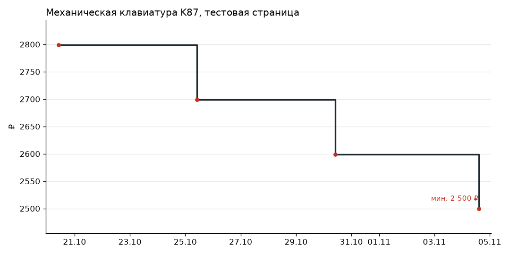

# pricewatch

Price tracker for Wildberries and any shop page: SQLite history, charts, Excel export and Telegram alerts.

Следит за ценами на Wildberries по артикулу и на любой странице магазина по CSS-селектору. Хранит историю в SQLite, строит графики, выгружает всё в Excel и пишет в Telegram, когда цена падает больше чем на заданный процент. Работает разовым запуском или как сервис в Docker.

[](https://github.com/hmsusbusas-png/price-watch/actions/workflows/tests.yml)
[](LICENSE)



```text
$ pricewatch add url https://example.com/k87 --selector "div#product span.price"
Добавлен №1: Механическая клавиатура K87, сейчас 2 599 ₽

$ pricewatch check
Механическая клавиатура K87                          2 599 ₽ → 2 499,90 ₽

$ pricewatch export --out prices.xlsx
Excel: C:\prices\prices.xlsx
```

## Возможности

- Источники: Wildberries (публичный API карточек и поиска) и любая страница с ценой в HTML. Селекторы: `tag`, `#id`, `.class`, `[attr=value]` и их цепочки через пробел.
- Цены вида `2 499,90 ₽`, `$1,234.56`, `от 3 200 руб.` разбираются в число.
- История в SQLite: новая запись появляется только когда цена изменилась.
- Уведомление в Telegram при падении цены на `ALERT_DROP_PERCENT` процентов и больше, со ссылкой на товар.
- `export` создаёт Excel со сводкой и отдельным листом на каждый товар с графиком Excel. `chart` сохраняет PNG.
- `search` выполняет поиск по Wildberries с выгрузкой выдачи в Excel.
- Сетевые ошибки и 5xx повторяются до трёх раз, один сломанный товар не останавливает проверку остальных.

## Как запустить

Нужен Python 3.11+ и [uv](https://docs.astral.sh/uv/).

```sh
git clone https://github.com/hmsusbusas-png/price-watch
cd price-watch
uv sync
cp .env.example .env        # в PowerShell: copy .env.example .env
uv run pricewatch add wb 155713071
uv run pricewatch check --dry-run
```

Команды:

| Команда | Что делает |
|---|---|
| `add wb <артикул>` / `add url <адрес> --selector <css>` | начать следить, сразу записывает текущую цену |
| `list`, `remove <№>` | список и удаление |
| `check [--dry-run]` | одна проверка; с `--dry-run` сообщения печатаются, а не отправляются |
| `watch` | проверять по кругу раз в `CHECK_INTERVAL_MINUTES` |
| `history <№>`, `chart <№>` | история в консоли и график в PNG |
| `export --out prices.xlsx` | вся история в Excel |
| `search "<запрос>" --excel out.xlsx` | поиск по Wildberries |

Настройки в `.env` (пример в `.env.example`): `TELEGRAM_BOT_TOKEN`, `TELEGRAM_CHAT_ID`, `CHECK_INTERVAL_MINUTES`, `ALERT_DROP_PERCENT`, `PRICEWATCH_DB`. Неверные значения проверяются при старте: программа скажет, что не так, и не запустится.

### Как сервис в Docker

```sh
docker build -t pricewatch .
docker volume create pricewatch-data
docker run --rm -v pricewatch-data:/data --env-file .env pricewatch add wb 155713071
docker run -d --name pricewatch --restart unless-stopped -v pricewatch-data:/data --env-file .env pricewatch
```

Последняя команда запускает `watch`, база лежит в томе `pricewatch-data`.

## Как устроено

```
src/pricewatch/
  sources/        источники цен: base.py (запросы с повторами), wildberries.py, page.py (HTML и селекторы)
  storage.py      SQLite: товары и история
  checker.py      проверка и решение, о чём уведомлять
  report.py       Excel и графики
  telegram.py     отправка сообщений
  settings.py     .env и проверка значений
  cli.py          команды
```

Для нового магазина нужен класс с полем `kind` и методом `quote(target, selector)`, который возвращает `Quote(price, title)`. Его нужно добавить в `SOURCES` в `sources/__init__.py`.

Проверки: `uv run pytest` (45 тестов, сеть не нужна: HTTP подменяется), `uv run ruff check .`, `uv run mypy`. То же гоняет CI.

## Ограничения

- Wildberries отвечает 403 на запросы с зарубежных IP. Доступ с российского IP нужно проверить отдельно.
- Страницы, где цена появляется только после JavaScript, не прочитать: нужен браузер, а здесь обычный HTTP.
- Формат API Wildberries меняется без предупреждения. Разбор поддерживает и текущий (`sizes[].price`), и старый (`salePriceU`).

Раньше поиск, Excel и графики жили в отдельном репозитории wb-price-tracker, теперь всё здесь.

## Лицензия

MIT, см. [LICENSE](LICENSE).
